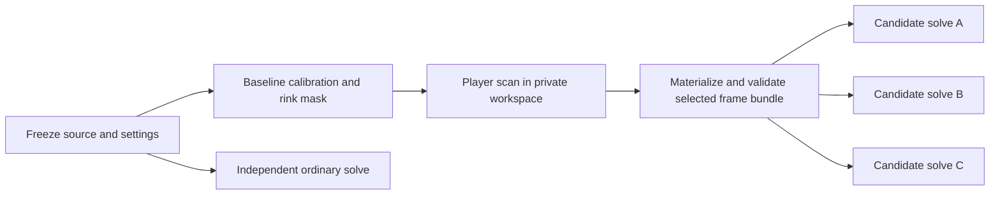

# Distributed experiment workflows

Status: accepted design for coordinated HockeyMONStream and HockeyMONWeb changes.
Two independent reviews and follow-up checks resolved the design findings.

## Problem and scope

Stitching experiment batches currently run one phase at a time. Independent solves
could use different available GPUs, but baselines, rink masks, player scans and
retained image bundles impose real dependencies. The Qt dialog owns local process
execution; the web service has a durable coordinator with one active child. A loop
that submits every candidate to Slurm would bypass both ownership models.

Implement optional distributed execution, durable progress and troubleshooting in
both interfaces, with the same scientific inputs and completion rules. Keep direct
local execution available. Generalize the execution plan, attempt lifecycle,
resource profiles and diagnostics so another native job family can use them later.
Normal Program publication, automatic result ranking, arbitrary user-supplied
commands, and a new general-purpose workflow language are outside this change.

The supported first GPU tasks use qualified NVIDIA deployments. Automatic
calibration/player scanning is an existing AMD CLI gap. Both desktop builds and
the browser expose the same workflow controls and explicit capability failures;
an AMD allocation must never silently execute an unsupported task or CPU fallback.

## Existing boundaries

- `StitchingExperimentBackend.*` validates candidate creation, source settings,
  player selection reuse, completion and explicit main-game promotion.
- `StitchingExperimentStore.*` owns private experiment history, dependency keys,
  revision CAS and frame-count reservations. Its current PID/session ownership is
  local-only and cannot prove a remote job stopped.
- `ConfigureStitching::create_control_points()` captures and publishes the complete
  selected PNG bundle before model initialization. Scanning alone freezes a plan,
  not those images. A standalone input materialization operation is new work.
- `hstream-job` exports one launch script with SBATCH directives. It does not submit
  jobs and ordinarily references configuration files that can change afterward.
- Web `experiment_sessions.py` owns the project across phases. `StreamRun`,
  `workflow.py`, `runner.py` and `operations.py` already provide durable submission,
  descendant containment, confined staging and exact native receipt verification.
- Web `stream_dagster.py` currently schedules dispatcher passes. It does not expose
  individual experiment stages or own their dependencies.

## Ownership decision

Keep one HStream coordinator responsible for each workflow's admission, dependency
release, cancellation, retry and artifact adoption. Slurm owns allocations and
process containment. Native code owns calibration semantics and result validation.
Qt/browser clients submit requests and observe; closing a submitted batch's view
detaches and does not cancel it.

Dagster is an optional operational graph observer, not a second submission owner.
One Dagster observation run represents a batch execution epoch and one graph operation represents a stage. Its
operations observe the durable HStream stage state; they never submit Slurm jobs,
retry native work, publish results or release ownership. The UI explicitly identifies
this as an observation run. HStream's Retry/Cancel actions remain authoritative.
Dagster outage cannot stop native work, invalidate results or require a rerun.

This differs from making Dagster the orchestrator: reusing the existing web
dispatcher preserves tested admission, receipts and cancellation, supports direct
execution without a Dagster installation, and avoids replacing those guarantees
with a second run database. A future orchestrator adapter must acquire the same
exclusive workflow lease; that extension is not required now.

## Shared plan and execution kernel

Provide a small Python module for bounded plan validation, ready-stage computation,
dependency outcomes, attempt transitions and graph projection. It contains no Qt,
Django, Dagster, GPU or subprocess dependencies. HockeyMONStream is its canonical
source; the web integration uses an explicitly synchronized copy with a byte-identity
check, as existing contract tooling does. Shared fixtures exercise both adapters.

A versioned plan has a workflow UUID, kind, immutable configuration/input identity,
runtime deployment identity, resource profiles and bounded stage records. Each stage
has a stable ID, display label, task kind, candidate ID, prerequisite IDs, typed input
references and profile ID. The experiment adapter emits the graph; the kernel does
not know what a baseline, mask, calibration or game is. Reject cycles, duplicate or
missing IDs, unsafe identities, unknown versions, excess nodes and unsupported task
kinds before submission. Store a canonical plan digest. Runtime states and attempt
history are separate from immutable plan data.

Typed task payloads are generated by trusted adapters. Browser requests contain
owned IDs and allowed choices, never paths, shell snippets, arbitrary environment
variables or executable names. Desktop CLI plans are private operator-owned files;
the scheduler still invokes fixed installed task entry points with argv arrays.

The desktop/CLI adapter owns a private workflow directory beneath the game's
`_hockeymon/` namespace, atomic fsynced state, an exclusive coordinator lock and an
append-only bounded event history. Lock support on the shared filesystem is a
deployment prerequisite. The web adapter persists attempts/membership using Django
ORM transactions and keeps its existing dispatcher lock. Neither adapter treats a
missing local PID as evidence about remote execution. Controllers are restartable;
they reconcile all unresolved attempts before admitting more work.

## Experiment graph

Candidate workspaces are durably prepared before they are advertised as queued.
Use the existing baseline and selection-owner relationships, including cross-session
workspace keys. Reuse must validate actual source context, start maps, reference
time, selection fingerprint and generation; equal frame counts alone are not proof.
Existing valid bundles satisfy their input node as `reused`, without a new scan.
Ordinary candidates and separate valid selection groups can progress independently.

Extract shared native experiment task functions from the existing backend/web-job
wrappers into a narrow CPU-linked task adapter. It launches the appropriate native
CLI on compute and reuses the same prepare/scan/reuse/complete validators. The
general workflow infrastructure must not link Highlights or CUDA libraries.

Add a native materialize-only mode that uses the existing exact selected-frame
replay/capture and `PlayerFrameInputStore` publication. Refactor input publication
from matching without adding another approximate seeker or video readback path.
Successful completion validates every PNG and its manifest, publishes the materialized
fingerprint, and exits without marking calibration complete or loading a matcher.
The web operation and desktop worker call this same mode. Matching failure must
never become a prerequisite failure after the frame bundle was successfully produced.

Each mutating stage/attempt gets a private writable successor workspace. Baseline
and bundle inputs are immutable after validated publication. In particular, the
current scan wrapper writes its launch recipe into the baseline: use a private
baseline clone for scans, preserving its verified calibration/mask identity. A
shared writable baseline is forbidden even when scans target different counts.

Freeze effective baseline, user overlay, game settings, source descriptors, optics,
start maps and native/config deployment identity at admission. A queued stage must
not resolve newer user defaults or a newly deployed binary. Retain original source
identity and absolute shared-mount bindings; validate on compute before GPU work.

Cross-host identities must be portable. Current native web receipts include
`st_dev` and the dispatcher compares it directly: NFS clients need not share that
number. Add a versioned distributed artifact identity containing the approved
storage namespace, confined relative path, size and SHA-256 digest, bound to the
exact native task/attempt receipt. Each host opens and pins the regular file without
following symlinks, checks its own full descriptor identity before and after hashing,
and rechecks the final path against its pin before adoption. Keep existing local
identity checks for local receipts; never reinterpret a legacy receipt as portable
by ignoring fields. Audit input aliases, staged companions, artifact adoption and
later reads for the same distinction. Bound bytes/files and stream hashes outside
HTTP handlers. Test different host-local device numbers, replaced paths, unchanged
size/mtime with changed bytes and concurrent mutation. Shared absolute paths remain
required; they are not by themselves proof of storage or content identity.

## Attempt lifecycle and failure rules

Stage states distinguish waiting for prerequisites, ready, submitting, queued,
running, cancelling, recovery, succeeded, reused, unavailable, failed, blocked and
cancelled. Attempt records bind workflow/plan digest, stage ID, attempt UUID,
scheduler cluster/job ID, task request digest, resource profile and output receipt.
Scheduler state and native/domain state remain separate.

Persist intent before every external submission. Use a stable unique Slurm name or
comment derived from the attempt UUID. Persist the returned job identity atomically.
If the connection or response is lost, search both queue and accounting for that
exact identity. An ambiguous or unavailable scheduler leaves `recovery`; never
blindly submit again. Disable Slurm requeue until restart semantics are explicitly
supported. A process exit or Slurm COMPLETED state alone cannot certify artifacts.

Release descendants only after the exact native receipt, generation and complete
input/output set validate and process containment confirms shutdown. Stale receipts,
partial bundles, source/config drift and results from an older attempt are rejected.
One unsuccessful candidate does not abort independent siblings. Insufficient player
coverage is `unavailable`, with blocked dependents and the ordinary baseline retained.
Dependency propagation reaches a terminal explanation even if no jobs can run.

Cancellation is durable before signalling, blocks new admissions, and wins over
later adoption once committed. Cancel only exact owned attempts through Slurm;
hold the workflow/project/workspace lease until all descendants and cleanup are
confirmed. Scheduler outage preserves recovery and ownership, never synthetic
success or safe-to-delete. A local executor uses an independently supervised
process session with equivalent shutdown proof. UI destruction cannot kill the
controller or release its lease.

Local shutdown uses a dedicated subreaper scope, never absence in a process
snapshot. The standalone task supervisor and CLI reap their own descendants until
the kernel returns `ECHILD`. A shared Qt process instead starts each operation
command through the Qt-free `hstream-process-guard`: a pinned, token/nonce-bound
permit exists before launch, and its completion acknowledgment appears only after
that guard reaches `ECHILD`. Qt keeps its normal QProcess ownership of the guard;
it never globally reaps unrelated children. Native Pause requests travel through
the permit to the guard, which stops a separate worker process group and confirms
the stopped worker before Qt reports Pause. The guard stays runnable throughout.
Stop escalation targets descendants while preserving the guard. Missing or
replaced proof, a killed guard, or a child
that cannot exit retains admission and capacity. FailedToStart may retire only a
permit whose guard never launched.

Native acquire, bind, adoption and release helpers inherit the controller's locked control
descriptor. Their short commit barrier survives controller death, so cancellation
cannot overtake an orphaned helper. A canceled uncertain acquisition is reconciled
against the exact native token before recording release. Retry requires confirmed
release before creating its new epoch. A durable verified adoption intent and an
exact read-only catalog query recover committed results after a lost response;
later cancellation preserves those successes without reopening their artifacts.
Definite local fork
rejection has a separate attempt-bound receipt; lack of a launch receipt alone is
still ambiguous.

Retry creates a new attempt and writable successor, retaining previous logs and
receipts. Retry only after old attempts are proven stopped. Reuse valid prerequisite
artifacts; do not rerun a scan because one solver failed. Retry of an unavailable or
failed prerequisite explicitly resets eligible blocked descendants, never completed
results. Editing scientific inputs creates a new plan/generation, not a disguised
retry. Initial automatic retry count is zero; explicit retry is available in both UIs.

Results become inspectable as each candidate validates. Playback, destructive
changes and promotion stay fenced by existing backend ownership rules; no new
concurrent preview/GPU ownership is implied. Promotion is still an explicit native
transaction and never an automatic fan-in stage.

## Resources and Slurm execution

Named operator profiles specify executor, partition, typed GRES, allowed nodes or
constraint, CPU count, memory, time limit, backend/architecture and exact native
deployment. User controls choose a published profile and maximum concurrent GPU
stages. Numeric values and profile names are validated; arbitrary SBATCH options
are not accepted from the browser. CPU preparation/validation does not reserve GPUs.

Do not reserve a parent GPU while waiting for child jobs. Slurm jobs contain the
standalone task supervisor and all descendants. Respect Slurm's visible-device
mapping; a host-global saved GPU number cannot select an unallocated GPU.

The first implementation submits independent jobs only when their verified inputs
are ready. Slurm `afterok` and arrays are not required: successful scheduler exit
cannot express native receipt validation. The explicit HStream DAG still permits
parallel admission and exposes every dependency. Arrays are a later optimization.

Profile readiness must be established for every eligible compute target. Current
web readiness assumes one nodelist target; replace that assumption with a frozen
qualified profile, compute-side identity/capability preflight, and target-specific
evidence. Generic `gpu:1` cannot span incompatible NVIDIA, AMD and Jetson runtimes.
Admission respects workflow, per-user and global limits without deadlocking on the
batch's own bookkeeping rows. Unknown/missing capabilities fail before allocation
of processing state. Report queue reason and allocated host/device when available.

## Desktop and web integration

Qt exports the native candidate plan, submits to the durable controller and polls
bounded snapshots asynchronously. Existing local execution uses the same workflow
contract. Desktop Slurm submission may use a configured submission host over SSH;
shared paths and installed entry points are checked before accepting a batch. No
passwords are persisted in plans. Export creates a directly runnable launcher and
plan; running directly uses the selected executor and explicit local override is
available. Export alone does not launch anything.

Add explicit remote workflow ownership to native experiment records. All reopen,
remove, discard, reservation and promotion checks recognize it. A single controller
owns catalog writes and imports verified task receipts using existing revision CAS;
parallel task workers do not race to rewrite the shared catalog.

Add one durable native game admission owner, separate from the per-workflow
coordinator lock. Acquire it under the game's admission lock before preparing a
batch, bind it to workflow/plan and controller identity, and retain it through
recovery and cleanup. A second workflow cannot acquire the same game. Main playback,
calibration/Clean, INT8 preparation, source/config mutations, experiment submission,
promotion and destructive cleanup consult this owner through a shared native
admission API; Qt dialog presence and local PID liveness are never the gate.
Admission and conflicting mutation serialize through the same game lock. Private
stage workspaces have their own exact task authorization and do not inherit a
blanket exception for the main game. Read-only inspection remains permitted.
On reopen or restart, Qt finds the durable owner and reattaches its progress view;
main-window controls reflect that owner even with no experiment dialog. Every
conflicting long-lived operation, including ordinary main playback/calibration and
INT8 preparation, reserves the same game owner for its full active and cleanup
lifetime. Batch admission rejects those existing owners under the same lock; merely
checking for a batch at main startup is insufficient. Short mutations hold common
admission exclusion through commit. A launch handoff binds the exact successor
process/task token without a release gap. Missing controller/scheduler evidence
preserves recovery. Test two windows and two processes in both admission orders
(main/INT8 first and workflow first), closing/restarting Qt, and conflicting
Clean/mutation requests during running, cancelling and recovery states.

The web session retains the project lease and candidate catalog. Add durable
workflow/stage-attempt membership and allow multiple `StreamRun` children only with
an exact session/stage/attempt admission capability. Update all three current
serialization gates: singular active child, admission validation and project idle
checks. Preserve preview's exclusive run identity separately. Toolbar Stop and
project cleanup discover all owning children through membership. Backend work from
another tab/project mutation remains prohibited until confirmed cleanup.

Both interfaces offer the same profile/concurrency controls, dependency graph,
selected-stage details, bounded live/retained logs, attempt history, retry and Stop.
Show dependency waiting separately from Slurm resource waiting. Selecting nodes or
reading logs remains possible while work runs. Closing Stitching Experiments asks
to cancel and waits for verified cleanup; keeping work running leaves the dialog
open. Reopen restores state and completed candidates after an unexpected exit. Each action
has the existing native icon; new controls inherit the application-wide wheel guard.
Do not show an invented percentage for unmeasured phases.

Use a graph rendered from the authoritative snapshot in each UI, with accessible
labels and a stage list/detail view. Optional Dagster links are operator-configured;
do not embed a privileged unauthenticated dashboard into customer pages. Qt/web
behavior comparison must cover execution and ownership, not only screenshots or
source fingerprints.

## Dagster observer

An installed code location loads bounded, sanitized workflow manifests from an
operator-owned registry. It builds one graph per registered plan with the same IDs
and edges. An explicit retry increments the workflow execution epoch. Register and
launch a new observation run for that epoch; terminal Dagster operations never need
to resume. Keep a stable workflow tag plus an epoch/observation identity and point
the UI at the current run while preserving earlier history. Successful retained
stages appear reused in the new observation. Registration/reload and observation-run
launch reconcile an ambiguous response instead of creating duplicate observers.
Observers read bounded status snapshots without running HStream mutations. Failure
and dependency skips are reflected; event metadata links stage attempts and Slurm
IDs. Observation run restart/re-execution never retries compute. Registration and
status publication failures surface as diagnostics while the HStream UI remains
authoritative. Limit retained definitions and clean them only after observers end;
retain historical Dagster runs. No dispatcher schedule is enabled automatically.
An observer that failed independently can restart as a new observation of the same
epoch with its own ID; that does not create a compute attempt or advance the epoch.
Test failure followed by native retry/success and observer-only failure/restart.
Late attachment after an outage projects the current epoch, including already
terminal and reused nodes, and retains historical epoch links when available.

## Installation and configuration

Provide an idempotent installer/checker with explicit modes:

1. `check`: read-only Slurm/accounting/cgroup, shared paths, runtime profiles,
   Dagster code location, heartbeat and HTTP checks; report actionable failures.
2. `integrate`: install pinned Dagster/adapter code, stable directories, systemd
   units and loopback web endpoint; preserve existing Slurm configuration, history,
   accounts, Munge key and scheduler ownership. Back up changed managed files.
3. `bootstrap`: explicitly supplied controller/compute topology and private Munge
   material; install/configure Slurm, accounting and cgroup containment. Refuse to
   overwrite an unmanaged existing cluster. Secrets never appear in logs or argv.

Use an operator manifest for site-specific topology and profiles, with no invented
partition/account/node defaults. Separate Slurm controller, compute and submission
roles. Validate configuration before activation, atomically replace managed files,
retain rollback copies, avoid restarts when unchanged, and verify after restart.
Do not delete state or rotate Munge keys on rerun. Existing-cluster repair must not
drain jobs or rewrite nodes as an incidental installer action. Document privileges,
shared storage, UID/path consistency, networking, accounting, diagnostics and
recovery. Application defaults live in canonical `configs/baseline.yaml`, synchronized
with HockeyMON; infrastructure secrets and deployment values remain operator inputs.

Ripper repair evidence: the missing `/home/colivier/dagster` working directory was
replaced by `/opt/dagster/code` through service drop-ins. Historical runs were kept;
no schedules were enabled. The existing HockeyMON single-node installer overwrites
Slurm configuration and disables accounting, so it is not safe to invoke on this
cluster. The new tooling must document this distinction and support the repaired
deployment without reinitializing its history.

Every managed deployment has an independently supervised HStream controller service:
the desktop/CLI installation supervises registered file-backed workflows; the web
installation runs `stream_worker` against its configured database. Direct foreground
CLI execution may act as that controller until it exits, leaving durable recovery
state for resume. Dagster observation services are never required to call `tick()`.
For an upgrade that currently relies on Dagster's `stream_dispatcher` schedule, the
installer records handover intent under the shared dispatch exclusion lock, releases
the lock, starts/verifies the new worker and its reconciliation against existing
run identities, then disables only that exact old dispatch schedule. Never wait for
a worker's reconciliation while holding the lock it needs. Make handover durable
and idempotent; a
crash at any point must leave at least one owner capable of reconciliation while
the shared lock prevents duplicate admissions. Preserve unrelated schedules,
notifications and historical runs. Do not silently alter an unrelated database's
dispatcher. Document standalone-worker and Dagster-only upgrade paths. Acceptance
stops Dagster after each upgrade and verifies new child admission, cancellation and
cleanup still progress through the independent HStream service.

## Acceptance and review gates

Review this design with two independent reviews, address necessary findings,
and repeat until clear. Then write the implementation plan and review it with two
new independent reviewers before product changes.

Required automated coverage includes DAG validation, shared-plan conformance,
parallel independent candidates, shared-baseline and shared-bundle reuse, multiple
counts/references, cached inputs, unavailable coverage, failed prerequisite/solver,
corrupt/missing/stale receipts, cancellation/completion races, duplicate requests,
submission timeout after acceptance, queue/accounting outage, controller restart,
retry fencing, quota/concurrency limits, multi-tab ownership and reopen/detach.
Installer tests cover idempotency, changed configuration, rollback, preexisting
cluster refusal, secrets and unavailable prerequisites.

Use actual local and Slurm GPU runs to establish scientific and lifecycle behavior,
including overlapping allocations, one extraction per shared selection, retained
results after a failed sibling, controller restart and cancellation. Exercise the
same native revision from Qt and browser, and record before/after screenshots outside
Git. Validate x86_64, ARM64/Jetson and relevant AMD capability rejection; report real
infrastructure limitations explicitly. An independent tester explores workflow
permutations end to end. After ready-for-review PRs, repeat two-reviewer fix/validation
rounds until no necessary findings remain, with test evidence before and after rounds.
