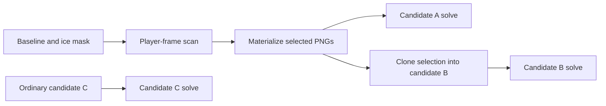

# Running and troubleshooting distributed experiment workflows

Stitching Experiments can submit independent calibrations to a qualified local or
Slurm resource profile. HStream owns the dependency graph, artifact verification,
retries and cancellation. Slurm allocates resources and contains descendants.
Dagster optionally displays the same stage graph and history; restarting or
terminating an observation does not control native compute.

See the [design](distributed-workflows-design.md),
[implementation plan](distributed-workflows-implementation-plan.md), and
[service deployment instructions](workflow-deployment.md). Automatic calibration
and player-frame search retain the existing AMD limitations in
[AMD GPU support](amd-gpu.md). An unsupported profile must fail readiness, rather
than silently selecting another backend. The Jetson cross toolchain currently
excludes QtCore task adapters; do not advertise that deployment as a distributed
experiment target merely because its CLI cross-build succeeds.

## Graph and controls

With no resource profile selected, the existing local serial workflow remains
available. A configured profile exposes concurrency, dependencies, stage and
attempt details, logs, Stop, Retry and Export. Closing a submitted workflow's
pane detaches; reopening the recording reattaches to durable state. Stop is an
explicit cancellation request, and remains pending until descendants and private
runtime cleanup have stopped. The desktop and browser use the same graph states
and preserve successful siblings when a different solve fails.



Each executable stage is a graph node. A candidate can therefore span several
nodes. Materialization does not construct or provision a matcher. Its verified
PNG bundle remains available if the following solve fails. A failed or
unavailable prerequisite blocks descendants, while unrelated candidates
continue. Retry creates a new attempt and observation epoch, preserving verified
successful prerequisites. Retry is available after all attempts have stopped and
recording ownership has been released.

The recording has one durable operation owner. Main playback, INT8 preparation,
local experiment operations and distributed workflows respect the same owner,
including across independent desktop processes and window closure. Releasing a
GPU allocation alone does not release recording ownership before cleanup.

## Standalone configuration

`configs/baseline.yaml` owns the shipped `workflow` defaults. Set
`workflow.registry` through the normal user/game configuration to an operator
registry; `null` leaves distributed execution unconfigured. The registry must be
owned by the executing user and must not be writable by another user. Its
`config.json` has these fields:

```json
{
  "schema": 1,
  "defaults": {
    "max_parallel": 1,
    "poll_interval_ms": 1000,
    "command_timeout_seconds": 30,
    "shutdown_timeout_seconds": 30,
    "observer_timeout_seconds": 86400
  },
  "profiles": {},
  "admission_profile": "metadata",
  "allowed_game_roots": ["/srv/hockey/recordings"],
  "observer_registry": null
}
```

The empty `profiles` object is deliberately incomplete: install qualified
profiles before enabling the registry. Resolve `defaults` from the deployed
baseline, and use the exact same configuration for foreground and service
controllers. The separate baseline `workflow.metadata_resources` block supplies
CPU preparation resources to the web service; it is not part of this registry's
timing `defaults` object. `admission_profile` identifies a **local CPU** native task helper on
the controller architecture. It handles recording ownership and catalog adoption;
it need not be the executable deployed on a remote compute architecture.

Each profile has `executor` (`local` or `slurm`), `pool`, `task_command`, `runtime`,
`capabilities`, `resources`, `limits`, and `qualified_nodes`; `label` is optional.
No arbitrary scheduler arguments are accepted from a workflow. An illustrative
Slurm resource section is:

```json
{
  "gpus": 1,
  "cpus": 4,
  "memory_mb": 16384,
  "time_seconds": 1800,
  "partition": "gpu",
  "gres": "gpu:rtx5090:1",
  "nodes": ["meshy", "mini"],
  "constraint": "",
  "account": "",
  "qos": "",
  "devices": []
}
```

Choose values for the actual cluster. Each stage requests zero or one GPU. Slurm
assigns devices; native GPU stages address the allocation's logical device zero.
Local GPU profiles instead list qualified physical UUIDs in `devices`; registry
leases exclude a UUID across all local pools. Profiles sharing a pool must share
its executor, limits and device inventory. `limits` contains explicit
`concurrency` and `per_user` bounds. The workflow's own concurrency is a further
bound, not another pool allocation.

Profile IDs are configuration keys, separate from Slurm's GRES strings. IDs use
letters, digits, underscores, dots and hyphens; a colon belongs in `resources.gres`,
not the profile ID. For example:

| Profile ID shown in the UI | `resources.gres` | Eligible hardware |
| --- | --- | --- |
| `gpu` | `gpu:1` | Any GPU on the profile's qualified nodes |
| `gpu-rtx4090` | `gpu:rtx4090:1` | Qualified RTX4090 nodes |
| `nvidia-rtx5090` | `gpu:rtx5090:1` | Qualified RTX5090 nodes |
| `gpu-v100` | `gpu:v100:1` | V100 nodes, after runtime qualification |

These are operator choices, not compiled defaults. Configure them in the
registry's `config.json` and deploy the matching manifest. An untyped `gpu:1`
request still needs an explicit partition and node list: it must not select an
incompatible backend, architecture or userspace runtime. All nodes in a profile
use the same pinned runtime. If profiles overlap, give them the same `pool` and
limits so switching profiles cannot bypass the shared concurrency cap. Preserve
an existing pool name while admitted workflows still reference it.

Choose a typed profile when the recording needs hardware-specific codec support.
RTX4090 qualification uses 8-bit H.264; its decoder rejected the H.264 High 10
fixture that passed on RTX5090. The generic profile does not inspect media and
route unsupported codec profiles automatically. Use `nvidia-rtx5090` for those
High 10 recordings; this limitation does not imply that all 10-bit codecs fail.

Slurm must advertise the same typed GRES in its node definition and `gres.conf`;
adding a profile alone does not configure the scheduler. Reopen Stitching
Experiments to reload installed profiles. Select **Execution profile**, set
**Parallel stages**, add candidates to the batch and start or export it. The web
dispatcher uses its own operator profile configuration and needs the same
qualified definitions; updating a standalone registry does not deploy a web
service configuration.

The current V100 on `ripper` advertises `gpu:v100:1`, but its DeepStream 9.1
`nvvideoconvert` fails the NV12-to-NVMM-RGBA path used by frame materialization.
It is excluded from the generic profile, and `gpu-v100` is not enabled. A
successful allocation or `--capabilities` response is insufficient evidence to
enable it; first qualify a compatible runtime with actual stitching stages.

`runtime` identifies `backend` (`nvidia`, `amd`, or metadata-only `cpu`),
`architecture` (`x86_64` or `aarch64`), `storage_namespace`, and an absolute-path
`files` map of SHA256 digests. Pin the task executable, exporter, CLI, baseline,
application configuration, models and supervisor deployment used by that profile.
Native GPU tasks additionally use `exporter`, `cli`, `config`, and `root` runtime
paths. Slurm also needs a pinned absolute `python` interpreter available on every
qualified target. Install the controller package at the same path on compute
nodes or use a shared installation. The supervisor itself has no Dagster or web
database dependency.

For each Slurm node, `qualified_nodes[node].runtime_identity` must equal the exact
runtime object and `qualified_nodes[node].capabilities` must include the profile's
stage kinds. Qualification is evidence from actual target checks, not a way to
bypass checks. The compute worker rechecks pinned files, host architecture and
allocated node before launching. NVIDIA automatic experiment kinds are
`experiment-baseline`, `experiment-scan`, `experiment-materialize`, and
`experiment-run`. Metadata kinds are `experiment-create`,
`experiment-reuse-selection`, and `experiment-complete`. The CPU preparation
profile needs at least create and reuse-selection. Query the installed task's
`--capabilities` output and run a disposable native pipeline on each target.

Use immutable deployment directories. Rebuilding or replacing a pinned binary
is expected to fail runtime verification; an already-admitted workflow must not
silently use the replacement. The UI freezes the active user configuration and
its native-reference provenance into the plan. Attempts read that snapshot,
so later Defaults edits do not change sibling tasks. Queued candidate workspaces
also retain their frozen experiment settings and manual matches.

Desktop and command-line clients may run from a different checkout than the
installed controller. Registry commands resolve the controller pinned by the
admission profile, verify its launcher and Python package against every profile,
then run that installed command. This also applies to export and monitoring;
there is no separate host or launcher setting to synchronize. Missing, changed
or conflicting controller pins stop before submission. Repair the operator
registry or restore its installed release; do not add checkout paths to frozen
profiles to bypass the check. Admitted workers retain their original supervisor.
Desktop command failures are retained in the process diagnostic log as well as
displayed in the dialog.

## CLI and exported launchers

The package installs `hstream-workflow` and, on supported desktop targets,
`hstream-experiment-task`. From a source checkout the launcher is
`scripts/hstream-workflow`. Commands return bounded JSON suitable for a UI client.
For example, substituting actual registry, plan, workflow and stage identifiers:

```sh
hstream-workflow profiles --registry /srv/hockey/workflow-registry
hstream-workflow submit --registry /srv/hockey/workflow-registry --plan plan.json
hstream-workflow status --registry /srv/hockey/workflow-registry --workflow UUID
hstream-workflow log --registry /srv/hockey/workflow-registry --workflow UUID --stage STAGE
hstream-workflow events --registry /srv/hockey/workflow-registry --workflow UUID --stage STAGE
hstream-workflow cancel --registry /srv/hockey/workflow-registry --workflow UUID --epoch 0
hstream-workflow retry --registry /srv/hockey/workflow-registry --workflow UUID --epoch 0 --stage STAGE
hstream-workflow serve --registry /srv/hockey/workflow-registry
```

Read the current epoch from `status` before Stop or Retry. A control from an older
retry epoch is rejected. Cancellation intent is durable independently of the
controller's reconciliation lock, so status and Stop remain usable while the
controller checks scheduler state or hashes an artifact. Worker supervision sees
the attempt cancellation directly; queued Slurm allocations are cancelled by
reconciliation. The final bounded native catalog commit and cancellation are
serialized: a committed cancellation prevents adoption; a completed adoption is
retained if cancellation arrives afterward. Before adoption, the controller records
the exact verified attempt and outputs. If the response is lost, a read-only native
catalog query recovers the committed result, including when Stop arrives afterward.
This query does not reopen output artifacts or repeat adoption. A release helper
inherits the same control barrier, so an orphan from an earlier controller cannot
release ownership during a new retry. Cancellation needs exact shutdown and
cleanup proof, but does not need successful output files to remain available.

Export writes a sealed plan beside an executable launcher and does not submit:

```sh
hstream-workflow export --registry /srv/hockey/workflow-registry --plan plan.json --output experiment-batch.sh
./experiment-batch.sh
```

The launcher can also run within a CPU-only `sbatch` allocation. Child stages
request their own resources, including GRES. `run` acts as a foreground
controller; an independent `serve` service can continue after it exits. Repeated
submission of the exact UUID and plan reattaches without creating attempts. A
UUID cannot be reused with different inputs. A definite ownership conflict
rejects that workflow permanently until an explicit retry; it is not a delayed
submission that starts after the conflicting operation ends.

Browser exports use authenticated web admission, membership and quota checks.
They do not expose private web storage through the standalone CLI. See
HockeyMONWeb's deployment and parity documentation for its ORM-backed coordinator.

## Failure and recovery

State lives under `<recording>/_hockeymon/workflows/<UUID>/`. The registry contains
workflow pointers and shared reservations. Each attempt has its sealed request,
profile, scheduler submission intent, launch identity, native receipt, completion
proof, logs and private work directory. Keep these files for recovery; deleting a
PID, lock file or reservation is not proof that work stopped.

`recovery` means HStream cannot safely decide whether an external effect happened
or all descendants stopped. A lost `sbatch` response is reconciled by the exact
UUID job name, user, cluster and job ID through both `squeue` and `sacct`. A
conflicting comment is rejected; an absent accounting comment is supported on
clusters that do not retain comments. HStream never resubmits merely because a
queue query returned no row or failed. Slurm must use `proctrack/cgroup` and
`task/cgroup`, with working accounting. A successful scheduler exit still needs
a matching native receipt, content-verified artifacts, descendant shutdown and
runtime cleanup before catalog adoption.

Portable artifact schema 2 uses namespace, relative path, size and SHA256.
Descriptor and path checks remain local to each host; an NFS `st_dev` value is
not a portable identity. Files and their ancestors are pinned without following
symlinks during verification. The web adapter has additional qualified NFS
inode/mtime/ctime requirements for subsequent HTTP reads, documented in
[workflow deployment](workflow-deployment.md).

Inspect stage reasons, attempt IDs, scheduler IDs, resource requests and logs
before retrying. Standalone native logs retain two 8 MiB segments; `log` returns
at most the current segment's last 1 MiB. State transitions retain two 1 MiB
append-only diagnostic event segments; `events` returns at most 512 records and
can select one stage. `state.json` remains authoritative if a crash interrupts
a diagnostic append. Metadata and artifact verification also
have protocol bounds. Local supervisors require the kernel to report that no
children remain after reaping; an empty process-directory scan is not shutdown
proof because a child can fork during the scan. Python supervisors signal pinned
process descriptors and check kernel pidfd support before launching work. Python
builds without pidfd wrappers use the same libc interfaces; there is no numeric
PID signaling fallback. Native ownership checks keep
the CLI inside its own subreaper scope. Qt commands use the installed
`hstream-process-guard` and exact token-bound completion receipts, so unrelated Qt
children remain under their normal QProcess owners. Descendants that detach,
clear their environment or become unreadable still belong to the guard's kernel
scope. Native Pause asks the guard to stop its separate worker process group and
waits for acknowledgment. The guard remains responsive to parent death and
cancellation throughout. A missing local supervisor or killed guard cannot prove
that escaped children died, so ambiguous local shutdown retains ownership and capacity.
Restoring accounting, the expected deployment, storage or controller is safer
than discarding durable recovery state.

Dagster errors are reported separately and never stop native work. Its confirmed
run URL belongs to the current observation epoch. The service deployment guide
covers observer-only restart, retained historical runs, and installer rollback.

## Source ownership and checks

- `scripts/hstream_workflow/schema.py` and `graph.py`: pure plan/state contract,
  byte-synchronized into the web coordinator.
- `controller.py`, `state.py`, `local.py`, `slurm.py`, `supervisor.py`: standalone
  admission, shared reservations, execution, reconciliation and containment.
- `GameOperationOwner.*`: reciprocal durable recording ownership.
- `ExperimentTaskMain.cpp` and `ExperimentTaskRuntime.*`: typed native preparation,
  scan, materialization and solve; exact catalog adoption.
- `dagster_registry.py` and `dagster_observer.py`: sanitized, optional observation.

Run focused Python tests with `PYTHONPATH=scripts python3 -m unittest` over the
workflow graph, controller, Slurm, observer and installer test modules. The
corresponding graph/controller/Slurm Bazel targets are under `//scripts`.
`sync_stream_contract.py --check` checks both generated web controls and canonical
kernel bytes. Tests with mocked schedulers supplement actual local, Slurm,
Qt/browser and Dagster service validation; they do not establish target readiness.
